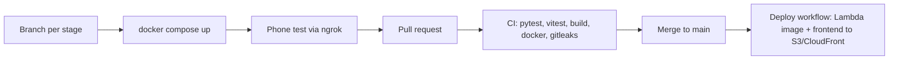

# Gym tracker

A web app for logging gym workouts and seeing progress over time: a built-in stopwatch,
structured sets (weight x reps, pre-filled from last time), a technique log of notes and photos
per exercise, and charts for consistency, strength per exercise, volume, and how the routine
has evolved. Years of training history logged in a WhatsApp chat are imported with their real
dates.

Designed phone first (that's where workouts get logged), and laid out as a dashboard on tablets
and computers, where visitors can open it as a guest and explore a private, temporary copy of
the real training log.

Built in stages alongside its sibling project, the
[pantry app](https://github.com/smvanegasp/pantry-mgmt-app), and shares its architecture.
**Status:** stage 0 (skeleton). The full plan is in [docs/BACKLOG.md](docs/BACKLOG.md).

## Stack

| Layer | Choice |
|---|---|
| Frontend | React 19, TypeScript, Vite, Tailwind CSS v4, TanStack Query, Phosphor icons |
| Backend | Python 3.12, FastAPI, boto3 (managed with uv) |
| Data | DynamoDB, single table, partitioned by space (owner log or guest sandbox) |
| Local dev | Docker Compose: API, DynamoDB Local, Vite dev server |
| Hosting (planned) | AWS: CloudFront, S3, API Gateway, Lambda (same Docker image), DynamoDB, SSM |
| Infra (planned) | Terraform |
| CI/CD | GitHub Actions: tests, build, Docker build, secret scan; deploy on merge via OIDC |

## How changes ship



The deploy workflow stays off until the AWS stack exists (repository variable `DEPLOY_ENABLED`).
It authenticates to AWS with GitHub OIDC, so no AWS keys are stored in GitHub.

## Run locally

Requires Docker Desktop. Host ports are chosen so this stack can run next to the pantry app's.

```sh
docker compose up -d --build     # app: http://localhost:5180   API docs: http://localhost:8090/api/docs
```

Test on a phone through a tunnel: `ngrok http 5180`.

## Tests

```sh
cd backend && uv run pytest -q          # moto: in-memory AWS, no real calls
cd frontend && npm test && npm run build
```

## Security and privacy

- Public repo: secrets, `.env` files, Terraform state and `*.tfvars` are git-ignored, and CI runs
  gitleaks on every push and pull request.
- The raw WhatsApp export stays in a git-ignored `private/` folder. Only the import code is in
  the repo; parsed workouts are written straight to the database.
- On AWS, secrets live in SSM Parameter Store (SecureString) and the API only accepts requests
  that come through CloudFront.

## Repo map

```
backend/        FastAPI app (app/, incl. the WhatsApp importer) and pytest suite (tests/)
frontend/       React app (src/pages, src/components, src/lib)
scripts/        deploy helpers, WhatsApp import CLI
.github/        CI, deploy and Dependabot
docs/           backlog and plan
AGENTS.md       working guide for coding agents (context, rules, status)
```
